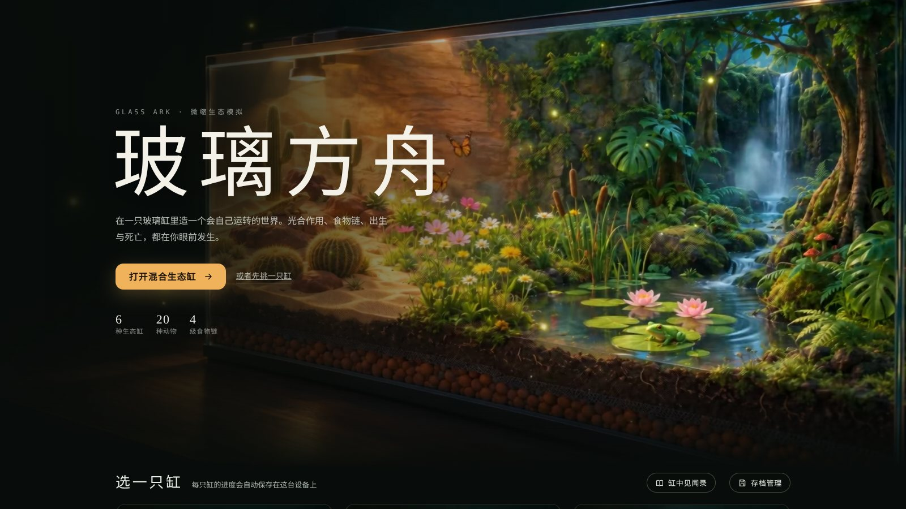
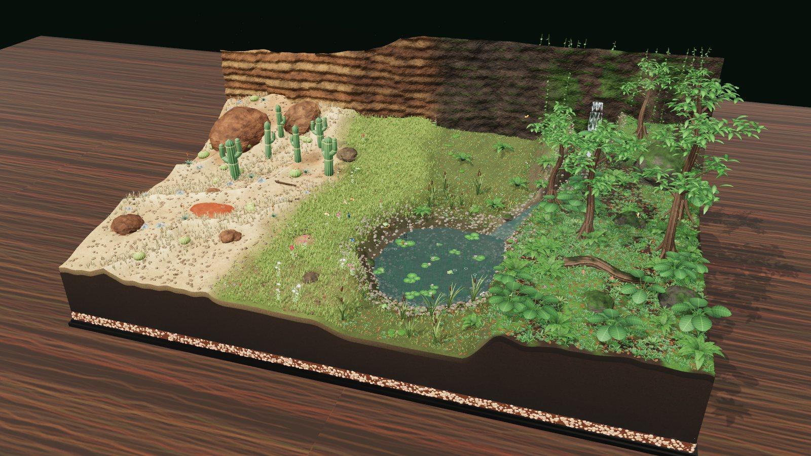
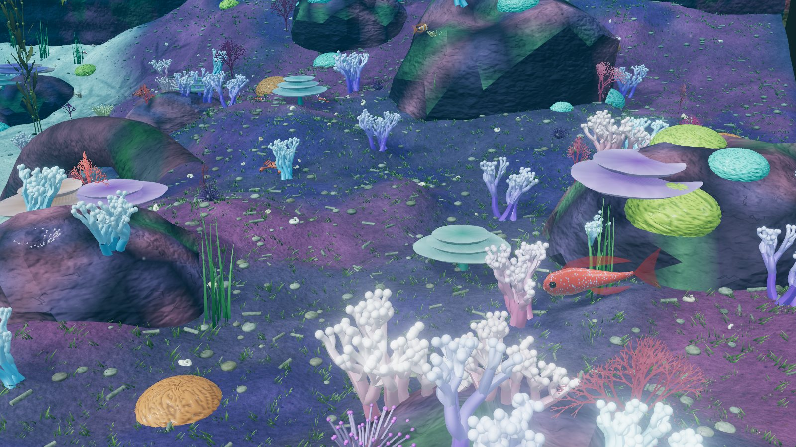
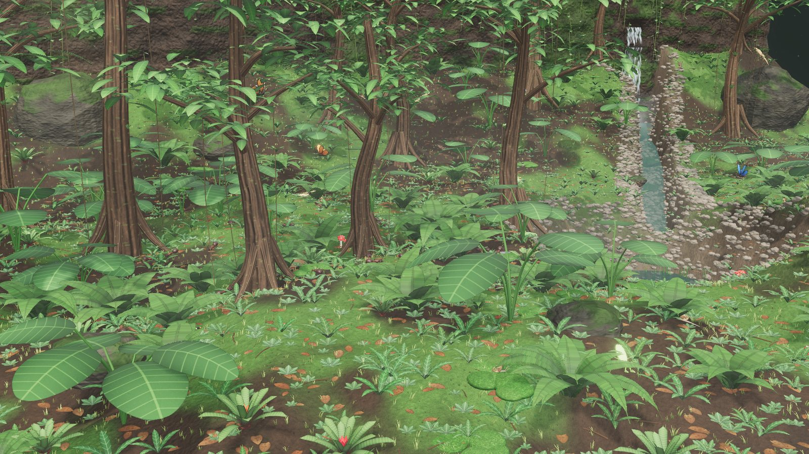
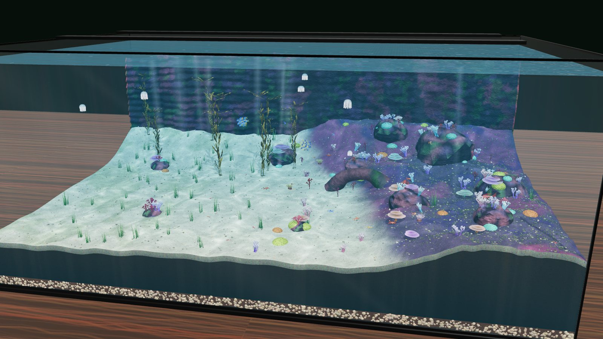
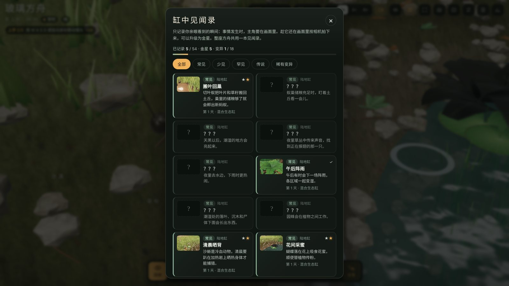
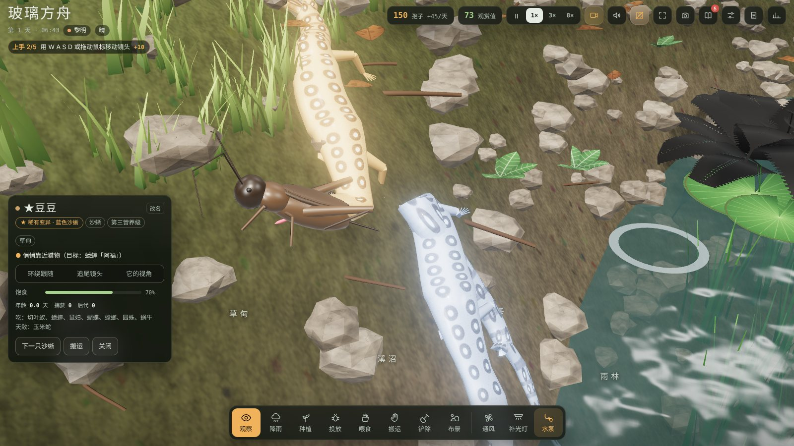
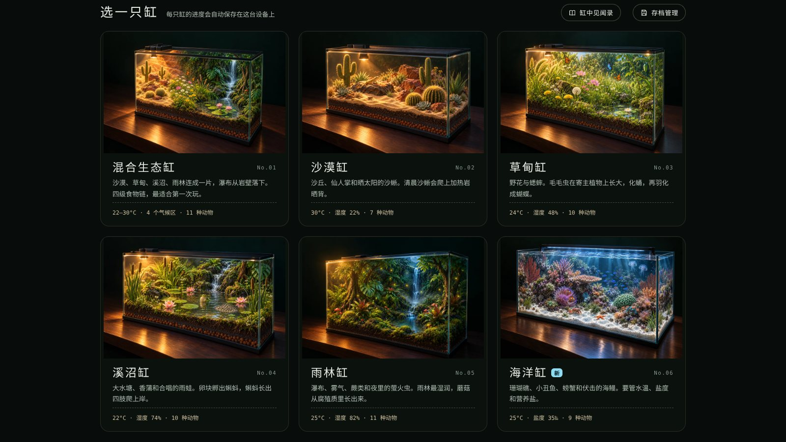
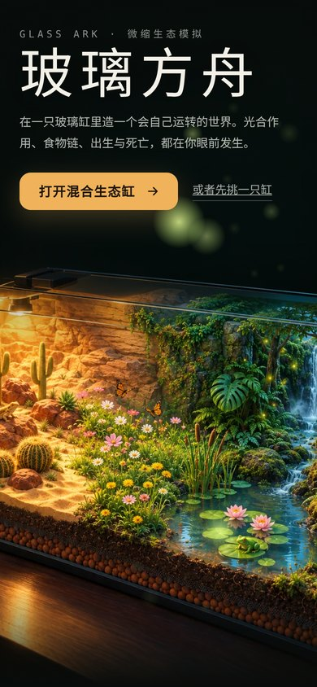

<div align="center">



# 玻璃方舟 · Glass Ark

**在一只玻璃缸里造一个会自己运转的世界。**<br>
光合作用、食物链、出生与死亡，都在你眼前发生。

<sub>A browser-based ecosystem god-sim built with three.js — raise a living terrarium or a coral reef in a glass tank.</sub>

<p>


</p>

[**在线试玩**](https://mingozhou.github.io/glass-ark/) · [快速开始](#-快速开始) · [更新日志](CHANGELOG.md) · [赞助](#-赞助) · [English](README_EN.md)

</div>

---

## 🌱 这是什么

《玻璃方舟》是一款网页端的生态缸经营养成游戏，玩法像“上帝模拟器”：**你不直接控制任何一只动物，只控制环境。** 降雨、种植、投放、喂食、摆布景、开关水泵和补光灯，然后看这个小世界自己长出故事。

- 🐜 蚂蚁搬叶子回巢，储粮够了就孵出新蚂蚁
- 🦋 毛毛虫在寄主植物上啃叶子，化蛹后羽化成蝴蝶
- 🕷️ 园蛛织网，螳螂伏在花枝上，雨蛙弹舌捕虫，玉米蛇站在食物链顶端
- 🐠 小丑鱼遇到危险钻进海葵，海鳗白天藏在礁石缝里，夜里出洞

整个游戏就是一个 HTML 文件加一份本地的 three.js：不用安装，不用构建，断网也能玩。

<table>
<tr>
<td width="50%"><br><sub><b>混合生态缸</b> · 隐藏玻璃后的沙盘视角，沙漠、草甸、溪沼、雨林连成一片</sub></td>
<td width="50%"><br><sub><b>海洋缸</b> · 飞进礁石区，珊瑚长在活石上</sub></td>
</tr>
<tr>
<td><br><sub><b>雨林缸</b> · 茂密的林下：龟背竹、蕨、苔藓和藤蔓</sub></td>
<td><br><sub><b>海洋缸</b> · 海草床、沙地、礁坪和礁石区四个区域</sub></td>
</tr>
</table>

## ✨ v1.2.0 更新亮点

> 完整内容见 [CHANGELOG.md](CHANGELOG.md)。

- **《缸中见闻录》**：54 条见闻，分常见、少见、罕见、传说四个难度。只记录你亲眼看到的瞬间，趁它还在画面里按相机拍下来，可以升级为金星
- **稀有变异**：繁殖时极少数新生命生来就是白化雨蛙、蓝色沙蜥、黑翅蝴蝶这样的稀有颜色，会遗传，商店里买不到
- **手机端菜单都能关了**：设置和两侧面板都有关闭按钮，点背景或用手机的返回手势也能关；再点一次当前工具就能收起它的列表

- **更好看的界面**：面板换成暖色玻璃质感，小字更清晰，滚动条更细；电脑上首页背景变成动态视频

<table>
<tr>
<td width="50%"><br><sub><b>缸中见闻录</b> · 亲眼看到的瞬间会被记下，拍到照片的升级为金星</sub></td>
<td width="50%"><br><sub><b>稀有变异</b> · 左边是普通沙蜥，右边是在缸里出生的蓝色变异个体</sub></td>
</tr>
</table>

<details>
<summary><b>v1.1.0 更新亮点</b></summary>

- **全新首页**：夜色插画主视觉 + 六只缸的标本卡片，手机和平板单独适配
- **开场镜头和导演模式**：进缸先看全景，再飞到一只动物身边；镜头会自动追踪捕猎、羽化、孵化
- **海洋缸重做**：珊瑚长在活石上，水更清更蓝，巨藻像飘带一样摇曳，雀鲷成群游动，水母夜里发光
- **雨林更茂密**：更多树和林下植物，树冠更厚，藤蔓更多，白天有斜射的光束
- **存档读档**：每只缸自动保存；首页的“存档管理”可以重命名、删除、导出和导入存档
- **画面修复**：泛光和景深终于正常工作，玻璃不再让画面发灰

</details>

## 🫙 游戏模式

| 模式 | 环境 | 看点 |
|---|---|---|
| **混合生态缸**（推荐） | 沙漠 · 草甸 · 溪沼 · 雨林连成一片，瀑布从岩壁落下 | 四种气候、11 种动物、四级食物链 |
| 沙漠缸 | 沙丘、仙人掌、加热岩 | 清晨沙蜥爬上加热岩晒背 |
| 草甸缸 | 野花、狗尾草、小水塘 | 蝴蝶完整变态发育，夜里蟋蟀鸣叫 |
| 溪沼缸 | 大水塘、香蒲、睡莲 | 雨蛙产卵、蝌蚪变态、雨夜合唱 |
| 雨林缸 | 雨林树、龟背竹、瀑布与雾气 | 萤火虫、蘑菇、潮湿的林下生态 |
| **海洋缸** | 海草床、沙地、礁坪、礁石区 | 珊瑚礁、鱼群、伏击捕食、水质管理 |

<details>
<summary><b>🐾 物种一览</b>（20 种动物，20 多种植物与珊瑚）</summary>

<br>

**陆地动物（11 种）**：切叶蚁、蟋蟀、蜗牛、蝴蝶（卵 → 毛毛虫 → 蛹 → 成虫）、鼠妇、萤火虫、园蛛、螳螂、雨蛙（卵 → 蝌蚪 → 成蛙）、沙蜥、玉米蛇

**陆地植物**：金琥、柱状仙人掌、芦荟、石莲花、狗尾草、雏菊、波斯菊、蒲公英、三叶草、香蒲、睡莲、蕨、苔藓、龟背竹、凤梨、雨林树，以及从腐殖质里自己长出来的蘑菇

**海洋动物（9 种）**：蓝魔雀鲷、小丑鱼、海月水母、清洁虾、螃蟹、海星、海胆、石斑鱼、海鳗

**海洋植物与珊瑚**：海草、巨藻、鹿角珊瑚、脑珊瑚、桌面珊瑚、海扇、海葵

高层捕食者要先把它的猎物养起来才能解锁：玉米蛇要求先有足够的沙蜥和成年雨蛙，海鳗要求先有石斑鱼和螃蟹。

</details>

## 🔬 模拟了什么

| 系统 | 内容 |
|---|---|
| **气体循环** | 植物白天光合作用放出 O₂、吸收 CO₂，动物全天呼吸；氧气曲线实时显示 |
| **水分与湿度** | 每个区域独立计算土壤湿度、空气湿度和温度，湿度过高会长霉 |
| **海洋水质** | 水温、盐度（蒸发会让盐度升高）、营养盐、浮游生物、藻类、溶解氧；水温超过 29°C 珊瑚会白化，营养盐过高会藻类爆发 |
| **行为** | 每只动物都有饥饿、繁殖、寿命和状态机：觅食、潜行、出击、扑空、逃跑、休眠；捕猎有命中率，也会失手 |
| **事件** | 午后阵雨、热浪、参观日、海洋热浪、浮游生物爆发 |
| **经济** | 观赏值（多样性 + 生态平衡 + 精彩瞬间）持续产出孢子，用来买植物、动物和布景；委托任务提供阶段目标 |

## 🎮 玩法与操作

**工具**：观察、降雨 / 补淡水、种植、投放、喂食、搬运、铲除（植物返还 30%，布景返还 50%）、布景（圆石、层岩、沉木、树桩、小瀑布岩、加热岩；海洋有活石、礁石拱门、沉船残骸、气石）

- **开场镜头**：进缸后先给整缸一个全景，再缓缓飞到一只动物身边（约 10 秒）。点击、滚轮、任意键或右下角“跳过”都能跳过。
- **导演模式**：默认开启，适合挂机观赏。拖动旋转或缩放只会让它在当前动物身上多停一会儿；用 W A S D 或右键平移就表示你接管了镜头，导演模式自动关闭，点右上角按钮可以重新打开。
- **面板**：委托和缸况面板默认收起，把屏幕留给缸体，右上角两个按钮可以展开。左上角的小标签会一直提示下一个上手任务。
- **缸中见闻录**：右上角的书本按钮（或按 J）。只有事情发生时主角在画面里才算看到；导演模式拍到的也算。相机按钮（或按 P）拍照：见闻发生后 12 秒内、离主角够近时拍下，这条见闻升级为金星，照片会贴进见闻录，也可以保存到设备。整座方舟共用一本见闻录，导出存档时会一起带上
- **稀有变异**：每次繁殖约有 0.5% 的概率生出变异个体，名字前带 ★；变异个体的后代有约三分之一的概率继承。出生时会弹出提示，点“去看看”就能找到它
- **存档**：每只缸单独自动保存（每 30 秒一次，切到后台或点“保存并返回首页”时也会保存），首页卡片上显示“存档 · 第 N 天”。首页的 **存档管理** 可以重命名、删除、导出成 JSON 文件备份，或在别的设备上导入。想从头再来，在设置里点“重新开始这只缸”。

<details>
<summary><b>⌨️ 按键与手势</b></summary>

<br>

| 操作 | 电脑 | 手机 |
|---|---|---|
| 旋转镜头 | 左键拖动 / Q E | 单指拖动 |
| 平移 | 右键拖动 | 双指拖动 |
| 缩放 | 滚轮 / R F | 双指捏合 |
| 飞行 | W S 朝视线方向前进后退，可以一直飞进缸里；A D 横移；Shift 加速 | — |
| 跟随生物 | 点击动物，选择“环绕 / 追尾 / 它的视角” | 同左 |
| 切换工具 | 数字键 1–8 | 底部工具栏 |
| 隐藏玻璃 | G | 顶部按钮 |
| 沉浸模式（隐藏界面，只留工具栏） | H，Esc 退出 | 顶部按钮，左上角退出 |
| 暂停 | 空格 | 顶部 Ⅱ |
| 拍照 | P | 顶部相机按钮 |
| 缸中见闻录 | J | 顶部书本按钮 |
| 收起工具列表、关闭面板 | Esc | 再点一次当前工具 · 面板里的 × · 点背景 · 返回手势 |

</details>

## 🚀 快速开始

游戏用的是 ES Module，浏览器不允许直接双击 HTML 加载模块，需要通过本地服务器打开。three.js 已经放在 `vendor/` 里，**不依赖任何 CDN，断网也能玩**。

| 方式 | 做法 |
|---|---|
| Windows | 双击 `start.bat`，浏览器会自动打开 `http://localhost:8765/`（需要装有 Python 或 Node.js） |
| Mac / Linux | 终端运行 `./start.sh` |
| 编辑器 | VS Code 装 Live Server 插件后右键“Open with Live Server”；JetBrains 系列点右上角的浏览器图标 |
| 手动 | 在仓库目录运行 `python -m http.server 8765`，然后访问 `http://localhost:8765/` |

如果页面顶部出现红色提示条，按提示操作即可。

**部署到 GitHub Pages**：仓库 Settings → Pages → Source 选 GitHub Actions（仓库里已经带了工作流），几分钟后就能通过 `https://<用户名>.github.io/<仓库名>/` 访问。

**画质**：首页和设置里可以选低 / 中 / 高。手机默认低画质：关闭实时阴影和后期处理，草的密度降到三成。高画质开启泛光、景深和高分辨率阴影。

<p align="center"> </p>

## 🛠️ 技术要点

- **three.js r165**（本地 vendor），ES Module + importmap，无打包器
- 物理光照单位、ACES 色调映射、PCF 软阴影、RoomEnvironment 环境光，可选 UnrealBloom 泛光和景深
- 植物和草通过 `InstancedMesh` 实例化，风的摆动写在顶点着色器里
- 蛇、蜥蜴、蝌蚪、海鳗用自定义的“脊柱管体”蒙皮，身体沿轨迹蜿蜒
- 蚂蚁腿部步态在着色器里驱动，上百只蚂蚁一次绘制
- **水下光照**参考了 [Tidewater](https://github.com/dgreenheck/tidewater) 的模型：光线按 Beer-Lambert 定律逐通道衰减（红光最先被吸收），视线穿过的水同样衰减并叠加散射的水色，焦散调制直射阳光而不是额外叠加亮度
- 声音全部用 Web Audio 合成，并做了空间定位：雨蛙的脉冲鸣叫、蟋蟀振翅、雨声、瀑布声
- 存档存在浏览器的 `localStorage` 里，每只缸约 30 KB，可导出为 JSON

<details>
<summary><b>📁 项目结构</b></summary>

```
.
├── index.html            # 构建好的游戏
├── start.bat / start.sh  # 一键启动本地服务器
├── build.sh              # 把 src/ 拼成 index.html
├── vendor/three/         # three.js r165 及用到的插件（MIT），离线可用
├── src/
│   ├── head.html         # 页面结构、样式、首页
│   ├── js1.js            # 渲染器、程序化贴图、首页萤火虫与模式选择
│   ├── js2.js            # 地形、区域、水体、岩石、缸体、水下光照
│   ├── js3.js            # 植物：程序化建模、实例化渲染、生长
│   ├── js4.js            # 陆地动物模型（骨骼管体、实例化蚂蚁）
│   ├── js4o.js           # 海洋动物模型（鱼、海鳗、虾蟹、水母）
│   ├── js5.js            # 陆地物种行为与捕猎系统
│   ├── js5o.js           # 海洋物种行为
│   ├── js6.js            # 模拟主循环、天气、经济、委托、初始生态
│   ├── js7.js            # 镜头、拾取、工具交互
│   ├── js7d.js           # WASD 飞行、布景、铲除、气泡
│   ├── js8.js            # 声音、界面、每帧视觉、主循环
│   ├── js9.js            # 开场镜头、导演模式、上手任务、存档与存档管理、手机面板
│   └── js10.js           # 缸中见闻录、拍照、稀有变异
├── assets/home/          # 首页插画（webp）
└── docs/screenshots/     # README 截图
```

修改 `src/` 后运行 `./build.sh` 重新生成 `index.html`。缸里的所有模型、贴图和声音都是代码程序化生成的；唯一的外部美术是 `assets/home/` 里的首页插画。

</details>

## 🗺️ 路线图

- [x] 存档与读档（每只缸自动保存，支持导出 / 导入）
- [ ] 微信小游戏版本（按区块加载，手机端降低实例数量）
- [ ] 更多物种：蜂类、蝾螈、章鱼、海龟
- [ ] 自由地形雕刻

## 🙏 致谢

- [three.js](https://threejs.org/)（MIT）
- [Tidewater](https://github.com/dgreenheck/tidewater)（MIT，© DRG Software Solutions LLC）：水下光照模型参考
- 字体：[ZCOOL XiaoWei](https://fonts.google.com/specimen/ZCOOL+XiaoWei)、[JetBrains Mono](https://www.jetbrains.com/lp/mono/)（SIL Open Font License）

## 📜 许可

**个人使用**：自由下载、运行、修改和游玩，无需额外授权。

**商业用途**：需事先获得作者书面授权。商业用途包括但不限于：收费运营、嵌入付费产品、商业推广、作为付费服务的一部分。如需商业授权，请通过 GitHub Issues 联系。

代码部分基于 [MIT License](LICENSE) 开放；美术、音效、游戏设计等创意内容保留所有权利（非商用）。

---

## ☕ 赞助

如果觉得这个游戏有点意思，可以请作者喝杯咖啡，您的支持是Mingo继续开发下去的动力！！

<p align="center"></p>

<p align="center"><sub>纯自愿，不影响游戏任何功能。你的 Star 和 Issue 反馈同样珍贵。</sub></p>
