<div align="center">

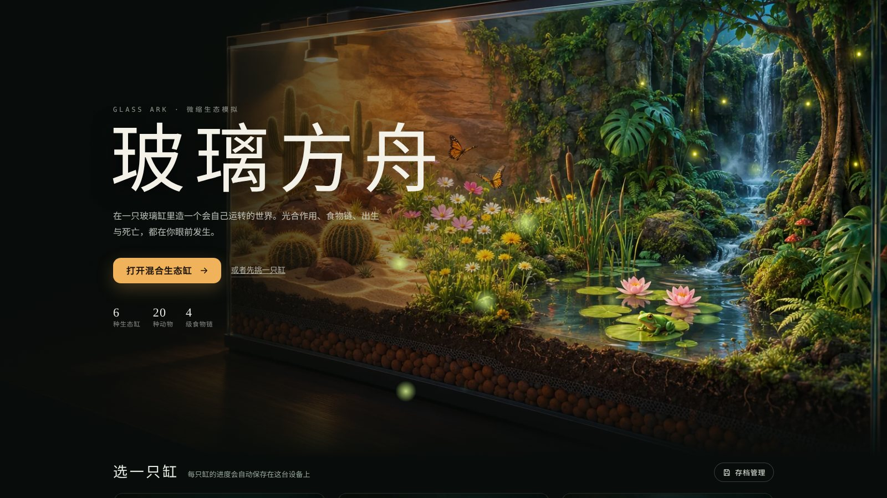

# Glass Ark · 玻璃方舟

**Build a self-sustaining world inside a glass tank.**<br>
Photosynthesis, food chains, birth and death — all unfold before your eyes.

<sub>一款基于 three.js 的浏览器端生态缸上帝模拟器——在玻璃缸里养出一个活生生的微型世界。</sub>

<p>


</p>

[**Play online**](https://mingozhou.github.io/glass-ark/) · [Quick start](#-quick-start) · [Changelog](CHANGELOG.md) · [Sponsor](#-sponsor) · [中文](README.md)

</div>

---

## 🌱 What is this?

Glass Ark is a browser-based ecosystem terrarium simulator. You play as the "god" of this tiny world — but **you don't control any creature directly, only the environment.** Trigger rain, plant vegetation, introduce species, feed them, arrange decor, switch the pump and grow light on and off, then watch the little world write its own stories.

- 🐜 Ants carry leaves back to their nest; when food stores are sufficient, new ants hatch
- 🦋 Caterpillars chew on host plants, pupate, and emerge as butterflies
- 🕷️ Spiders spin webs, mantises ambush from branches, tree frogs catch insects with their tongues, corn snakes sit atop the food chain
- 🐠 Clownfish dart into anemones when threatened; moray eels hide in reef crevices by day and hunt at night

The entire game is a single HTML file plus a local copy of three.js: nothing to install, no build step, fully playable offline.

<table>
<tr>
<td width="50%">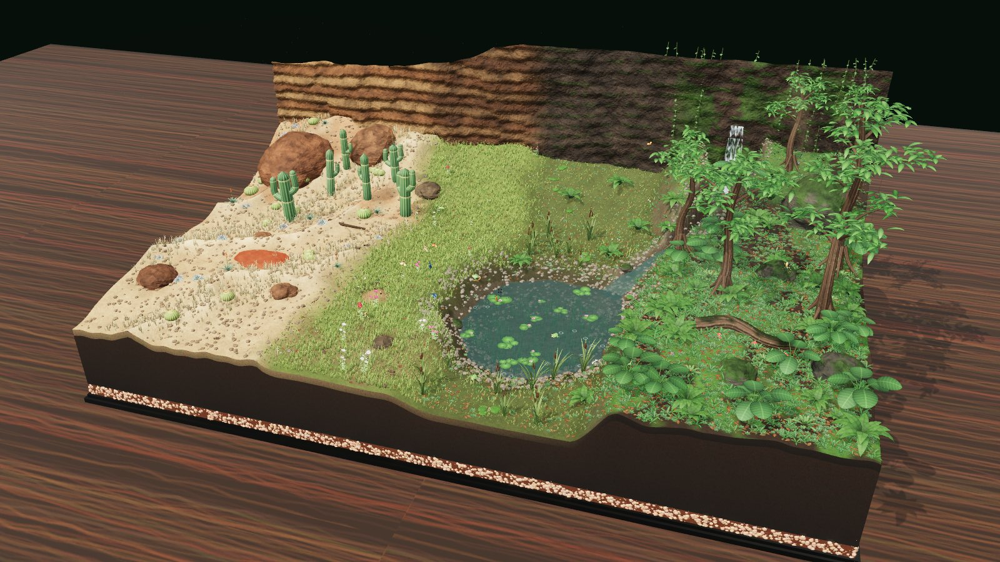<br><sub><b>Mixed tank</b> · diorama view with the glass hidden: desert, meadow, marsh and rainforest in one tank</sub></td>
<td width="50%">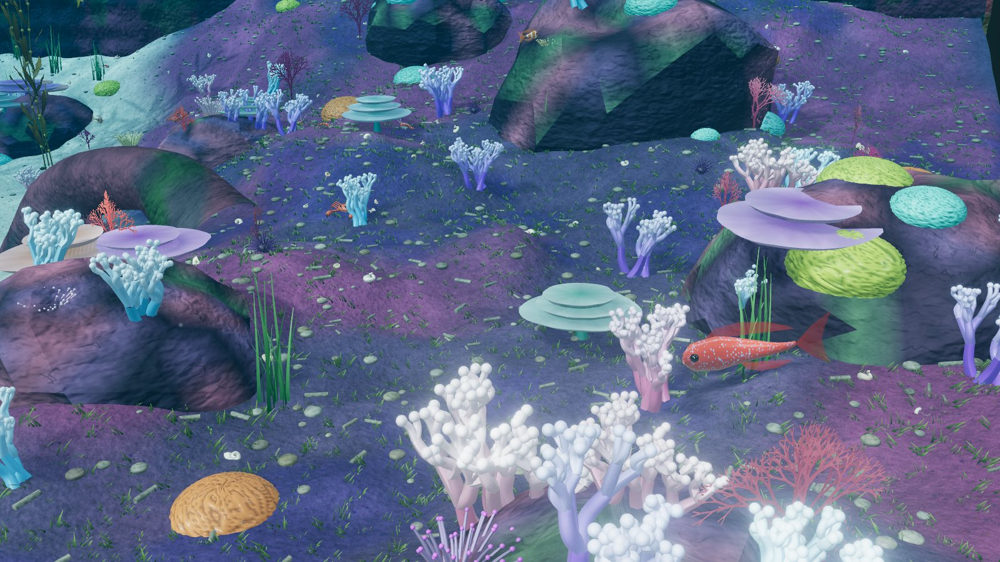<br><sub><b>Ocean tank</b> · fly into the reef, where corals grow on the live rock</sub></td>
</tr>
<tr>
<td>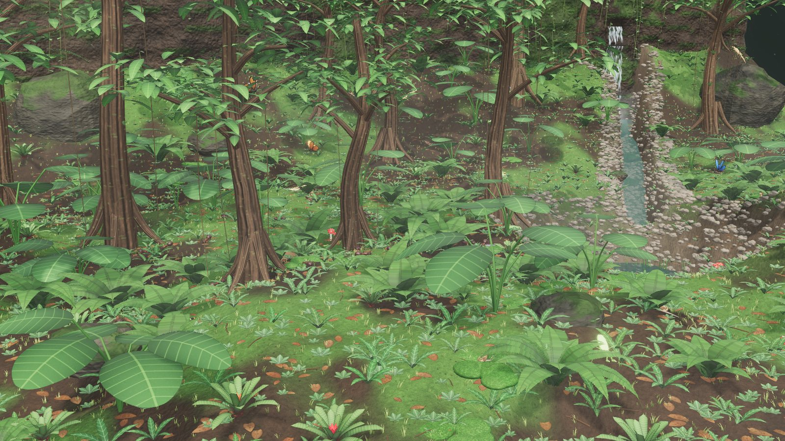<br><sub><b>Rainforest tank</b> · a dense understorey of monstera, ferns, moss and vines</sub></td>
<td>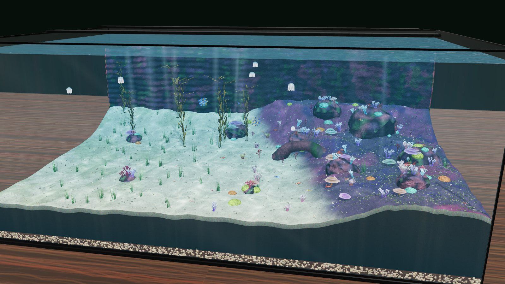<br><sub><b>Ocean tank</b> · seagrass bed, sand flat, reef flat and reef zone</sub></td>
</tr>
</table>

## ✨ What's new in v1.4.0 · Desktop mode

> Full details in [CHANGELOG.md](CHANGELOG.md).

- **Desktop build**: the game can now be packaged as a Windows desktop app that runs offline and keeps its saves on your machine ([build it yourself](#-desktop-build-make-your-own-exe))
- **Desktop mode**: click the monitor icon at the top right of a tank and the game shrinks into a small frameless window in a corner of your screen. Every panel hides, the camera follows the action on its own, and the tank keeps running quietly while you work
- Hover the small window for a top bar: drag, pin on top, size (S / M / L), opacity, back to the full window, save and quit
- The small window and the full window share one save and save before switching; position and settings are remembered, and the system tray can switch too
- A new app icon

<p align="center">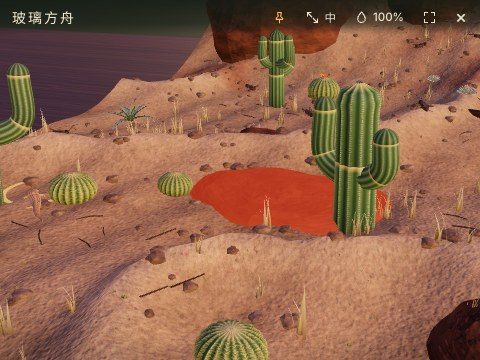 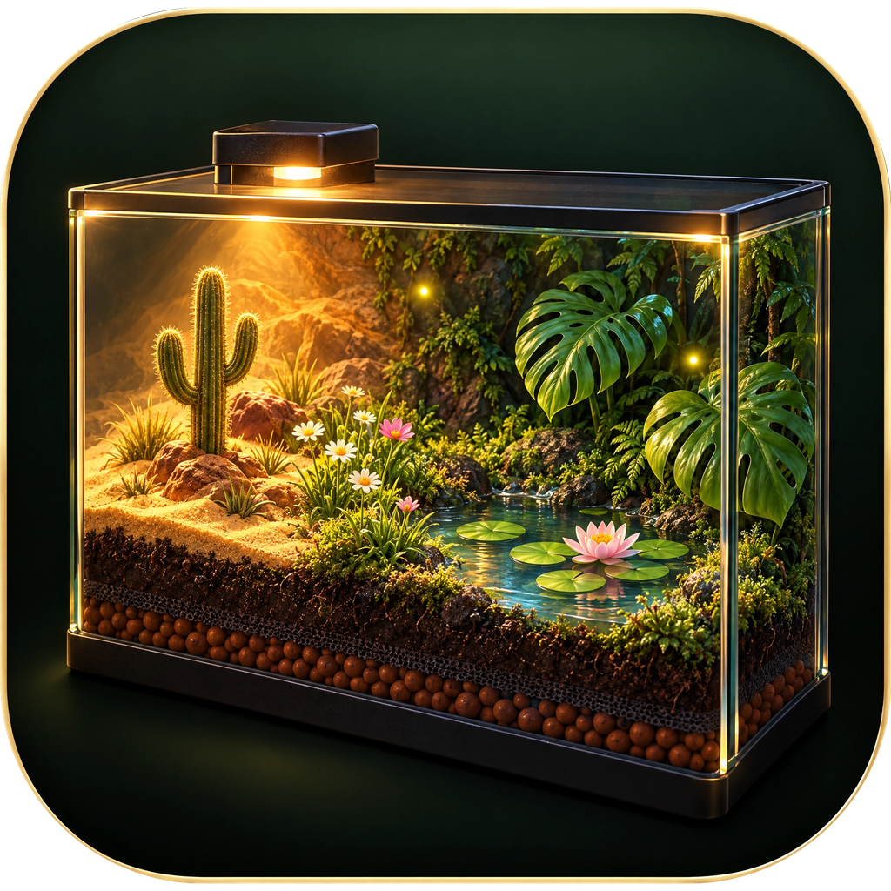<br><sub><b>Desktop mode</b> · a small frameless window; the bar appears on hover</sub></p>

<details>
<summary><b>What was new in v1.3.0 · Creative tank</b></summary>

- **Creative tank**: start from an empty tank. Press and drag to lay sand, gravel, soil, turf, mud, moss and leaf litter, raise hills, dig hollows and fill them with water, then place rocks and plants. What you lay is what grows. Everything is free while you build; open the tank and release animals when you're happy
- **Water rebuilt**: clear in the shallows and greener with depth, with reflections, ripples, rain rings and caustics on the bed; in the creative tank, tap a hollow to fill it
- **A window to the sky**: the back of the tank is now a window with perspective and parallax on the sky, clouds and far hills; the light inside follows the sky — warm at dawn, pink at dusk, grey in the rain
- **Hands-on decor**: press and drag rocks and driftwood; they follow the terrain and can't leave the glass. Rotate, resize, copy or delete them; low grass makes way underneath and grows back when you move them. Copy the whole layout as text and import it later
- **New interface**: the Tank Journal and every pop-up panel share one look — green glass with fine gold edges — and journal cards now show the animal's portrait
- **中文 / English**: the whole game is bilingual; switch on the home page or in Settings
- **Controls**: Space rises, Ctrl sinks (all the way down to the ground), and the animal card can be folded away in director mode

<table>
<tr>
<td width="50%">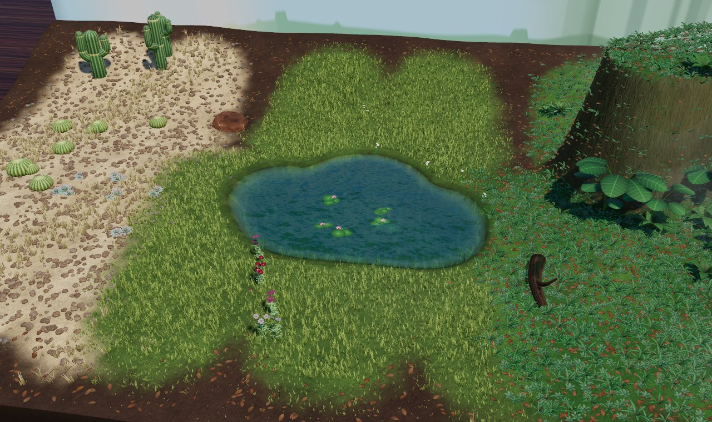<br><sub><b>Creative tank</b> · lay substrate, dig and fill ponds, place decor</sub></td>
<td width="50%">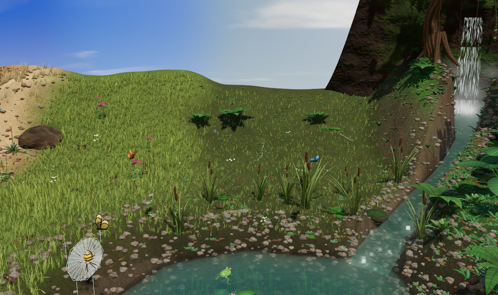<br><sub><b>Window sky</b> · clouds and hills shift with the view, the light follows the sky</sub></td>
</tr>
<tr>
<td>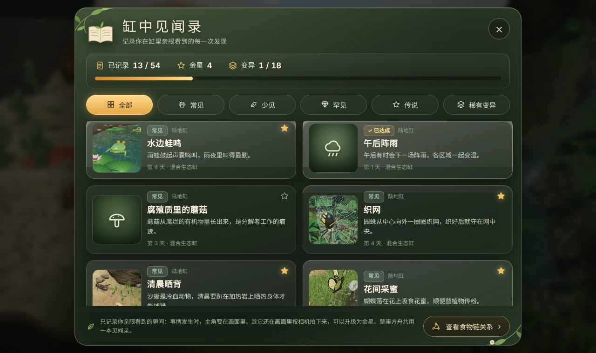<br><sub><b>Tank Journal</b> · redesigned, with a portrait for every moment</sub></td>
<td>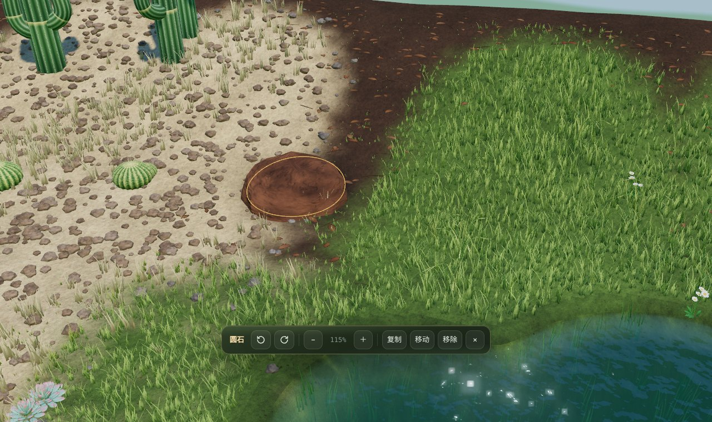<br><sub><b>Decor editing</b> · drag, rotate, resize, copy; grass makes way underneath</sub></td>
</tr>
</table>

</details>

<details>
<summary><b>What was new in v1.2.0</b></summary>

- **缸中见闻录 (Tank Chronicle)**: 54 moments in four tiers — common, uncommon, rare and legendary. Only moments you actually see count; snap a photo while it's still on screen to upgrade it to a gold star
- **Rare mutations**: a tiny share of newborns come out as an albino frog, a blue lizard, a black-winged butterfly and more. They're heritable and can't be bought
- **Every menu closes on phones**: settings and both side panels have a close button, and tapping the backdrop or the phone's back gesture closes them; tap the active tool again to fold its list away

- **A nicer interface**: warm glass panels, sharper small text and slim scrollbars; on desktop the home page background is now a living video

<table>
<tr>
<td width="50%">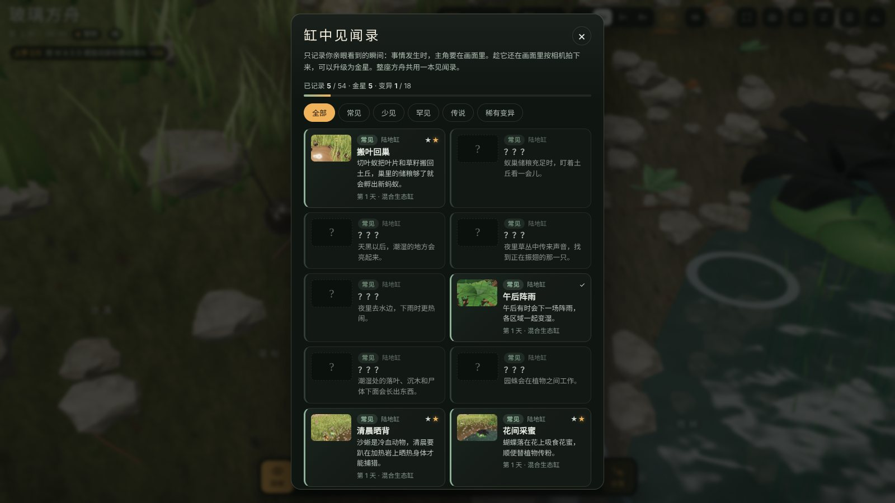<br><sub><b>缸中见闻录 (Tank Chronicle)</b> · moments you witness are recorded; photographed ones earn a gold star</sub></td>
<td width="50%">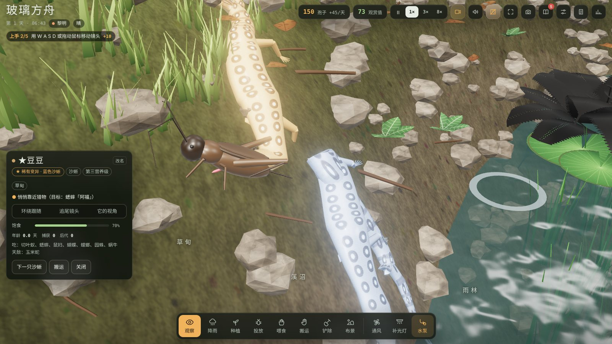<br><sub><b>Rare mutations</b> · an ordinary lizard on the left, a blue mutant born in the tank on the right</sub></td>
</tr>
</table>

</details>

<details>
<summary><b>What was new in v1.1.0</b></summary>

- **New home page**: a night-time illustrated hero and specimen cards for all six tanks, tuned for phones and tablets
- **Opening shot and director mode**: each tank opens on a wide shot, then glides to an animal; the camera follows hunts, metamorphoses and hatchings on its own
- **Ocean tank rebuilt**: corals grow on live rock, clearer and bluer water, kelp streams like ribbons, damselfish swim in schools, jellyfish glow at night
- **Lusher rainforest**: more trees and understorey, fuller canopies, more vines, and slanting light shafts by day
- **Save and load**: every tank autosaves; the home-page save manager can rename, delete, export and import saves
- **Rendering fixes**: bloom and depth of field finally work, and the glass no longer washes the picture out

</details>

## 🫙 Game modes

| Mode | Environment | Highlights |
|---|---|---|
| **Mixed** (recommended) | Desert · Meadow · Marsh · Rainforest in one tank, with a waterfall down the rock wall | Four climates, 11 animals, four-level food chain |
| Desert | Dunes, cacti, heat rock | Lizards bask on the heat rock at dawn |
| Meadow | Wildflowers, foxtail grass, small pond | Full butterfly metamorphosis, crickets chirping at night |
| Marsh | Large pond, cattails, water lilies | Frog spawning, tadpole metamorphosis, rainy-night chorus |
| Rainforest | Rainforest trees, monstera, waterfall and mist | Fireflies, mushrooms, a damp understorey |
| **Ocean** | Seagrass bed, sand flat, reef flat, reef zone | Coral reef, fish schools, ambush predators, water-quality management |
| **Creative** | Start from an empty tank and lay 7 substrates yourself | Raise and dig, fill ponds, place decor freely, then open the tank |

<details>
<summary><b>🐾 Species</b> (20 animals, 20+ plants and corals)</summary>

<br>

**Land animals (11)**: leafcutter ants, crickets, snails, butterflies (egg → caterpillar → pupa → adult), isopods, fireflies, garden spiders, mantises, tree frogs (egg → tadpole → adult), sand lizards, corn snakes

**Land plants**: golden barrel cactus, saguaro, aloe, echeveria, foxtail grass, daisy, cosmos, dandelion, clover, cattail, water lily, fern, moss, monstera, bromeliad, rainforest tree, plus mushrooms that sprout from leaf litter on their own

**Ocean animals (9)**: blue damselfish, clownfish, moon jellyfish, cleaner shrimp, crabs, starfish, sea urchins, grouper, moray eels

**Ocean plants and corals**: seagrass, giant kelp, staghorn coral, brain coral, table coral, sea fan, anemone

Top predators unlock only after you've raised their prey: corn snakes need enough lizards and adult frogs first; moray eels need grouper and crabs.

</details>

## 🔬 What's simulated

| System | Details |
|---|---|
| **Gas cycle** | Plants photosynthesize by day (release O₂, absorb CO₂), animals breathe around the clock; live oxygen chart |
| **Moisture and humidity** | Each zone tracks its own soil moisture, air humidity and temperature; too much humidity grows mold |
| **Ocean water quality** | Temperature, salinity (evaporation raises it), nutrients, plankton, algae, dissolved oxygen; corals bleach above 29 °C and too many nutrients cause an algae bloom |
| **Behavior** | Every animal has hunger, reproduction, lifespan and a state machine: forage, stalk, strike, miss, flee, rest; hunts can fail |
| **Events** | Afternoon showers, heat waves, visitor days, marine heat waves, plankton blooms |
| **Economy** | Viewing score (diversity + balance + highlight moments) earns spores for plants, animals and decor; contracts give you goals |

## 🎮 Playing

**Tools**: observe, rain / top up fresh water, plant, release, feed, move, remove (plants refund 30%, decor 50%), decor (boulder, layered rock, driftwood, stump, mini waterfall rock, heat rock; in the ocean: live rock, reef arch, shipwreck, air stone)

- **Language**: Chinese and English. The first launch follows your browser language; switch any time at the bottom of the home screen or in Settings (switching inside a tank saves first and reopens the same tank)
- **Opening shot**: each tank opens on a wide shot, then glides to an animal (about 10 seconds). Click, scroll, press any key or tap "跳过" (skip) to skip it.
- **Director mode**: on by default, made for idle viewing. Rotating or zooming just keeps it on the current animal a little longer; moving with W A S D or right-drag hands the camera to you and turns director mode off. Turn it back on with the top-right button.
- **Panels**: the contracts and tank-status panels start collapsed so the tank gets the screen; open them with the two top-right buttons. A chip in the top-left always shows the next onboarding task.
- **缸中见闻录 (Tank Chronicle)**: the book button at the top right (or J). A moment counts only if its subject is on screen when it happens; director mode counts too. The camera button (or P) takes a photo: within 12 seconds of a moment and close enough to its subject, the entry becomes a gold star and the photo goes into the chronicle; you can also save it to your device. All tanks share one chronicle, and it travels with exported saves
- **Rare mutations**: about 0.5% of births are a mutant, marked with ★ before its name; a mutant's offspring inherit it about a third of the time. A notice pops up when one is born — tap "去看看" (go see) to find it
- **Saving**: every tank autosaves on its own (every 30 seconds, when the tab goes to the background, and when you press "保存并返回首页" — save and return home). Home cards show a "存档 · 第 N 天" (saved · day N) badge. The **存档管理** (save manager) on the home page can rename and delete saves, export them to a JSON file, and import them on another device. To start over, use "重新开始这只缸" (restart this tank) in Settings.

<details>
<summary><b>⌨️ Controls</b></summary>

<br>

| Action | Desktop | Mobile |
|---|---|---|
| Rotate camera | Left-drag / Q E | One-finger drag |
| Pan | Right-drag | Two-finger drag |
| Zoom | Scroll / R F | Pinch |
| Fly | W S move along the view, right into the tank; A D strafe; Shift speeds up | — |
| Follow a creature | Click an animal, then choose orbit / chase / its view | Same |
| Switch tool | Number keys 1–8 | Bottom toolbar |
| Hide glass | G | Top button |
| Backdrop on / off | B | “背景板” in the toolbar |
| Immersive mode (hide UI, keep toolbar) | H, Esc to exit | Top button, exit at top-left |
| Rise / sink | Space / Ctrl | — |
| Pause | Top Ⅱ | Top Ⅱ |
| Take a photo | P | Camera button at the top |
| Tank Chronicle | J | Book button at the top |
| Fold the tool list, close panels | Esc | Tap the active tool again · × in the panel · tap the backdrop · back gesture |

</details>

## 🚀 Quick start

The game uses ES Modules, which browsers won't load from a double-clicked HTML file, so open it through a local server. three.js is bundled in `vendor/`: **no CDN needed, fully playable offline.**

| Option | How |
|---|---|
| Windows | Double-click `start.bat`; the browser opens `http://localhost:8765/` (needs Python or Node.js) |
| Mac / Linux | Run `./start.sh` in a terminal |
| Editor | VS Code: install Live Server and choose "Open with Live Server"; JetBrains IDEs: click the browser icon at the top right |
| Manual | Run `python -m http.server 8765` in the repo folder and visit `http://localhost:8765/` |

If a red banner appears at the top of the page, follow its instructions.

**Deploy to GitHub Pages**: Settings → Pages → Source: GitHub Actions (the workflow is already in the repo). A few minutes later it's live at `https://<username>.github.io/<repo>/`.

**Quality**: choose low / medium / high on the home page or in Settings. Phones default to low: no real-time shadows or post-processing, grass density at 30%. High enables bloom and high-resolution shadows.

<p align="center">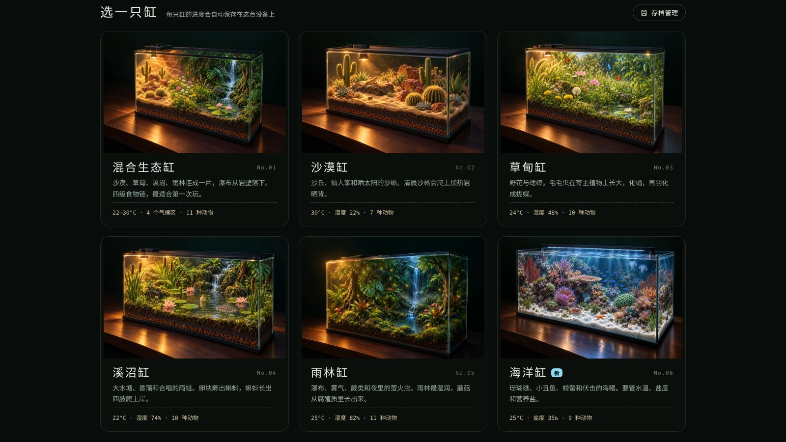 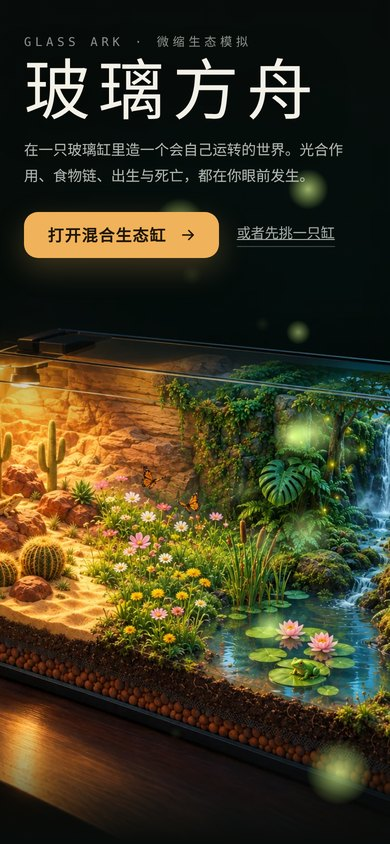</p>

## 🖥 Desktop build: make your own exe

The desktop version lives in `desktop/` and is packaged with Electron. Install [Node.js](https://nodejs.org) first (LTS, 20 or newer).

```bash
bash build.sh        # in the repo root: only needed after changing code in src/, regenerates index.html
cd desktop
npm install          # first time only, downloads Electron and the packager
npm start            # run without packaging
npm run dist         # package for Windows
```

The result is in `desktop/dist/`:

- `win-unpacked/Glass Ark.exe` runs with a double-click; keep the whole `win-unpacked` folder together
- a zip with the same content sits next to it

No local setup? Run **Actions → Build desktop (Windows) → Run workflow** in the GitHub repo and download `GlassArk-win` from the bottom of that run's page. Pushing a tag that starts with `v` builds it too.

See [desktop/README.md](desktop/README.md) for desktop mode controls, files and font bundling.

## 🛠️ Technical highlights

- **three.js r165** (vendored), ES Modules + importmap, no bundler
- Physically based light units, ACES tone mapping, PCF soft shadows, environment lighting generated from the sky, optional UnrealBloom
- Plants and grass use `InstancedMesh`, with wind sway in the vertex shader
- Snakes, lizards, tadpoles and moray eels use a custom "spine tube" skin whose body follows its path
- Ant leg gaits run in the shader, so hundreds of ants render in one draw call
- **Underwater lighting** follows the [Tidewater](https://github.com/dgreenheck/tidewater) model: per-channel Beer-Lambert absorption along the light path (red goes first), the same along the view path plus scattered water color, and caustics that modulate direct sunlight instead of adding brightness
- All sound is synthesized with Web Audio and spatialized: tree-frog pulse calls, cricket chirps, rain, waterfall
- Saves live in the browser's `localStorage` (about 30 KB per tank) and can be exported as JSON

<details>
<summary><b>📁 Project structure</b></summary>

```
.
├── index.html            # The built game
├── start.bat / start.sh  # One-click local server
├── desktop/              # Desktop build (Electron): windows, tray, desktop mode; see desktop/README.md
├── build.sh              # Concatenates src/ into index.html
├── vendor/three/         # three.js r165 and the add-ons it uses (MIT), works offline
├── src/
│   ├── head.html         # Page structure, styles, home page
│   ├── i18n.js           # Chinese / English: the TR`…` tag and the English dictionary
│   ├── js1.js            # Renderer, procedural textures, home-page fireflies and mode selection
│   ├── js2.js            # Terrain, zones, water, rocks, tank, underwater lighting
│   ├── js3.js            # Plants: procedural modeling, instanced rendering, growth
│   ├── js4.js            # Land animal models (spine tubes, instanced ants)
│   ├── js4o.js           # Ocean animal models (fish, moray, shrimp, crabs, jellyfish)
│   ├── js5.js            # Land species behavior and hunting
│   ├── js5o.js           # Ocean species behavior
│   ├── js6.js            # Simulation loop, weather, economy, contracts, initial world
│   ├── js7.js            # Camera, picking, tool interaction
│   ├── js7d.js           # WASD flight, decor (drag, rotate, resize, copy, layout import / export), removal, bubbles
│   ├── js8.js            # Sound, UI, per-frame visuals, main loop
│   ├── js9.js            # Opening shot, director mode, onboarding, saves and save manager, phone panels
│   ├── js10.js           # Tank Chronicle, photos, rare mutations
│   └── js11.js           # Creative tank: substrate and terrain brushes, water fill / drain, opening the tank
├── assets/home/          # Home-page illustrations (webp)
└── docs/screenshots/     # README screenshots
```

After editing `src/`, run `./build.sh` to regenerate `index.html`. Every model, texture and sound in the tanks is generated in code; the only external art is the home-page illustrations in `assets/home/`.

</details>

## 🗺️ Roadmap

- [x] Save and load (per-tank autosave, export / import)
- [ ] WeChat mini-game version (chunked loading, fewer instances on phones)
- [ ] More species: bees, salamanders, octopus, sea turtles
- [x] Free terrain sculpting (creative tank, v1.3.0)
- [x] Chinese / English
- [x] Desktop build and desktop mode (v1.4.0)
- [ ] Steam release (achievements, cloud saves)

## 🙏 Acknowledgments

- [three.js](https://threejs.org/) (MIT)
- [Tidewater](https://github.com/dgreenheck/tidewater) (MIT, © DRG Software Solutions LLC): reference for the underwater lighting model
- Fonts: [ZCOOL XiaoWei](https://fonts.google.com/specimen/ZCOOL+XiaoWei), [JetBrains Mono](https://www.jetbrains.com/lp/mono/) (SIL Open Font License)

## 📜 License

**Personal use**: Free to download, run, modify, and play — no additional authorization required.

**Commercial use**: Requires prior written authorization from the author. Commercial use includes but is not limited to: paid operation, embedding in paid products, commercial promotion, or as part of a paid service. For commercial licensing, please contact via GitHub Issues.

Code is licensed under [MIT License](LICENSE); art, sound effects, and game design creative content retain all rights (non-commercial).

---

## ☕ Sponsor

If you enjoy the game, you can buy the author a coffee. Your support is what keeps Mingo developing it!

<p align="center"></p>

<p align="center"><sub>Entirely optional and doesn't affect any game features. Stars and issue reports are just as valuable.</sub></p>
